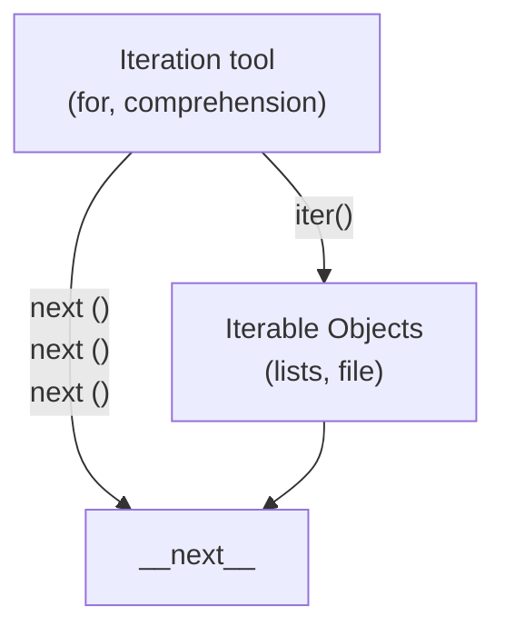

# Python Iteration Mechanism

**Example Data Structure:** `[1, 2, 3, 4]`

---

## Diagram Flow

---

## Components Explanation

1. **Iteration Tools:**
   - Constructs like `for` loops or list comprehensions (`[x for x in ...]`).
   - Call `iter()` to obtain an iterator from an iterable object.
   - Repeatedly invoke `next()` (or call `__next__()` under the hood) to retrieve elements one by one.

2. **Iterable Objects:**
   - Data structures such as lists (`[1, 2, 3, 4]`), tuples, strings, files, or custom iterable classes.
   - Passed to `iter()` to create an iterator stream.

3. **`__next__` Method:**
   - The underlying magic method that fetches the next item in the iteration sequence until raising a `StopIteration` exception.